# 💻 Práctica 05 — Consultas SELECT

## 🎯 1. Objetivo

Convertir preguntas humanas y necesidades de negocio reales en consultas SQL precisas y eficientes utilizando el comando `SELECT` y sus diferentes cláusulas de filtrado, operadores lógicos, patrones de texto, rangos y ordenamiento. Aprender a ir más allá de la recuperación de tablas completas, enfocándose en extraer exactamente la información requerida para la toma de decisiones, aplicando buenas prácticas de sintaxis y analizando el comportamiento de los datos en un entorno de base de datos relacional (MySQL / MariaDB).

## 2. 🗄️ Base de datos utilizada

* **Nombre de la base de datos:** `TiendaVideojuegos`

* **Descripción:** Entorno relacional diseñado para administrar el inventario de un establecimiento comercial de videojuegos. Permite registrar catálogos por plataforma, control de precios, stock disponible y el registro de transacciones de venta bajo estrictas reglas de integridad referencial.

## 3. 📋 Tablas utilizadas

### 🎮 1. Tabla: `Videojuegos`
Almacena el catálogo general e inventario disponible de los artículos en la tienda.
* **Estructura y Tipos de Datos:**
  * `id_videojuego`: `int(11)` (Clave primaria, Auto_increment)
  * `nombre`: `varchar(100)` (Clave única, No nulo)
  * `plataforma`: `varchar(50)` (Permite nulos)
  * `precio`: `decimal(10,2)` (Permite nulos)
  * `stock`: `int(11)` (Valor predeterminado: 10)
  * `genero`: `varchar(50)` (Permite nulos)

### 🛒 2. Tabla: `Ventas`
Registra las transacciones comerciales vinculadas al catálogo de videojuegos.
* **Estructura y Tipos de Datos:**
  * `id_venta`: `int(11)` (Clave primaria, Auto_increment)
  * `id_videojuego`: `int(11)` (Clave foránea relacionada con el catálogo)
  * `cantidad`: `int(11)` (Permite nulos)
  * `fecha`: `date` (Permite nulos)
  
## 📊 4. SELECT básico

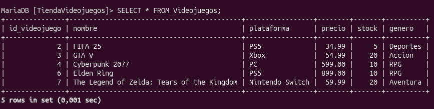

Se utilizó el comando `SELECT * FROM Videojuegos;` para seleccionar y mostrar todas las columnas disponibles en la tabla `Videojuegos`.

## 🎯 5. SELECT de columnas específicas

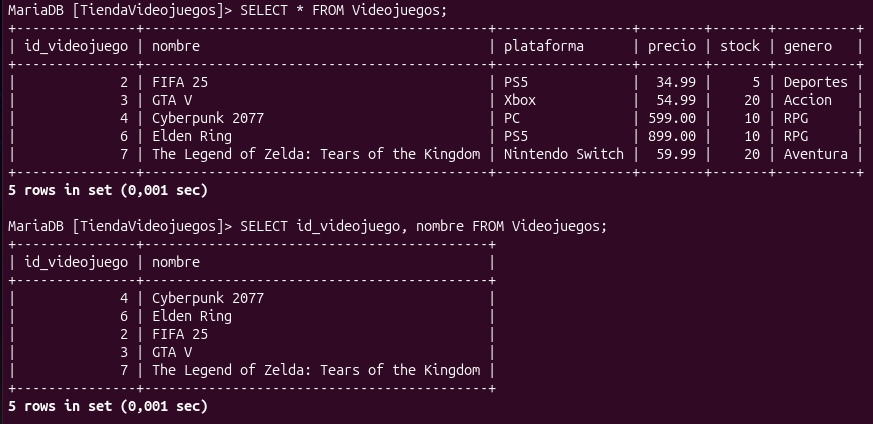

Se utilizó el comando `SELECT * FROM Videojuegos;` para seleccionar y mostrar todas las columnas disponibles en la tabla `Videojuegos`, y después se utilizó el comando `SELECT id_videojuego, nombre FROM Videojuegos;` para seleccionar y mostrar únicamente las columnas específicas de `id_videojuego` y `nombre` de los registros.

### 📝 Documenta

| Consulta | ¿Qué devuelve? |
| :--- | :--- |
| `SELECT *` | Muestra todas las columnas de la tabla |
| `SELECT columna1, columna2` | Muestra únicamente las columnas especificadas |

## 🔎 6. WHERE

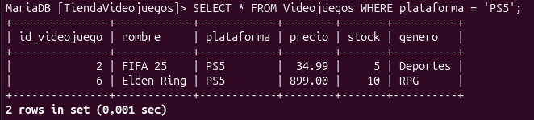

Se utilizó el comando `SELECT * FROM Videojuegos WHERE plataforma = 'PS5';` para mostrar los registros de la tabla `Videojuegos` que coincida exactamente con `PS5` para obtener los juegos que le corresponden.

### 📝 INVESTIGACIÓN

¿Qué diferencia existe entre: `=` y: `LIKE`?
El operador `=` se utiliza para buscar coincidencias exactas.
El operador `LIKE` se utiliza para realizar busquedas aproximadas o patrones.

## 🔢 7. Operadores

**1. Operador Mayor que (>) [Punto A]**

¿Cuáles son los videojuegos del inventario cuyo precio es mayor a 100.00?
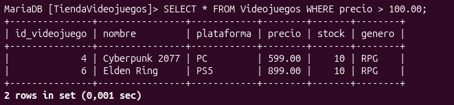

¿Qué significa el resultado?
Que solo existen dos títulos que su precio es mayor a 100.

**2. Operador Menor que (<) [Punto B]**

¿Cuáles son los juegos cuyo precio es menor a 100.00?
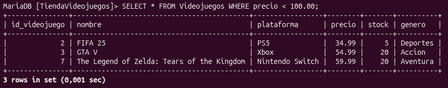

¿Qué significa el resultado?
Que solo hay dos titulos que su precio sea menor a 100.

**3. Operador Mayor o igual que (>=) [Punto C]**

¿Qué videojuegos cuentan con un stock disponible mayor o igual a 10 unidades?
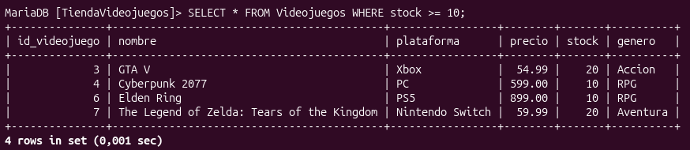

¿Qué significa el resultado?
Que solo muestra los productos que tienen un stock mayor o igual a 10.

**4. Operador Menor o igual que (<=) [Punto D]**

¿Cuáles videojuegos tienen un stock menor o igual a 10 unidades?
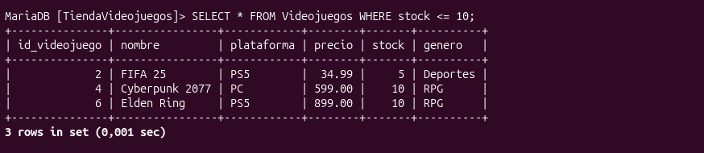

¿Qué significa el resultado?
Muestra los productos que están por agotarse

**5. Operador Diferente de (<>) [Punto E]**

¿Cuáles videojuegos NO pertenecen a la plataforma de PS5?
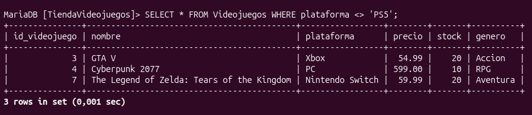

¿Qué significa el resultado?
Excluye todos los juegos de una consola en especifico y muestra los demas.

## 🔤 8. LIKE

**A) Nombres que comiencen con una letra determinada**

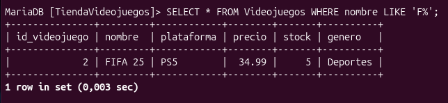

**Explicación:**Filtra y devuelve únicamente los registros donde el título inicia con la letra "F".

**B) Nombres que terminen con una secuencia determinada**
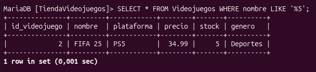

**Explicación:**Muestra registros que terminen con el número "5".

**C) Nombres que contengan una palabra o fragmento**
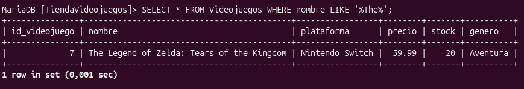

**Explicación:**Muestra solo los registros que comiencen con "The".

## 📋 9. IN 

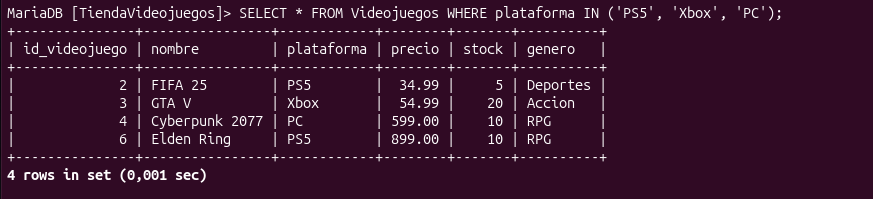

**¿Qué hace el operador `IN`?**
Permite buscar varios valores evitando escribir varios `OR`.

## 📏 10. BETWEEN

**A) Una consulta utilizando un rango numérico (Precios)**

`SELECT nombre, precio FROM Videojuegos WHERE precio BETWEEN 30.00 AND 100.00;`

**Explicación:** El operador `BETWEEN` simplifica la búsqueda dentro de un intervalo cerrado, evitando usar condiciones combinadas con operadores de mayor o menor igual.

**B) Una consulta utilizando otro rango que tenga sentido para tu proyecto (Stock)**

`SELECT nombre, stock FROM Videojuegos WHERE stock BETWEEN 5 AND 20;`

**Explicación:** Simplifica la busqueda de la cantidad de productos que quedan sin utilizar el mayor o menor igual.

**C) Comprobación de límites**

Valor inicial: 30.00

Valor final: 100.00

¿Se incluyó el inicial?: Sí

¿Se incluyó el final?: Sí 

Evidencia:

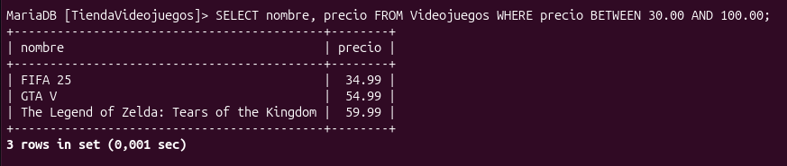

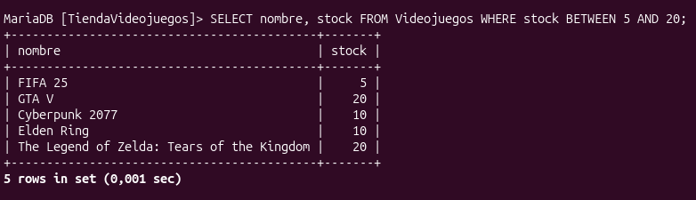

## ❓ 11. IS NULL / IS NOT NULL

Se utilizó el comando `SELECT * FROM Videojuegos WHERE genero IS NULL;` para comprobar que no existen registros con valores vacíos o nulos en dicha columna (devolviendo un conjunto vacío), y posteriormente se utilizó el comando `SELECT * FROM Videojuegos WHERE genero IS NOT NULL;` para filtrar y mostrar todos los registros que sí cuentan con un género asignado correctamente.

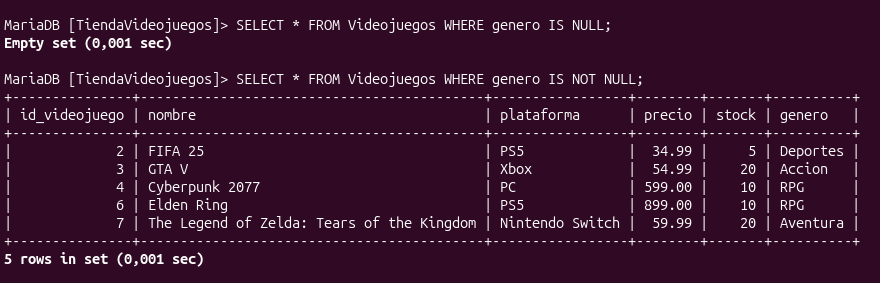

### 📝 RESPONDE

1. ¿Cuántos registros tienen NULL?
Respuesta: 0 registros.

2. ¿Cuántos no tienen NULL?
Respuesta: 5 registros.

3. ¿Qué diferencia existe entre ambas consultas?
Respuesta: `IS NULL` busca los registros donde no hay información.
`IS NOT NULL` hace lo contrario, muestra los registros que si tienen información.

4. ¿Qué problema de información puede revelar un NULL?
* Datos incompletos o errores de capturas: información que el usuario olvida ingresar.
* Falta de integridad o estandarización: desconocimiento del dato.

5. ¿Cuándo puede ser válido permitir NULL?
Es válido y útil permitir valores NULL en situaciones donde la informació es opcional o aún no se conoce.

## 🧹 12. DISTINCT

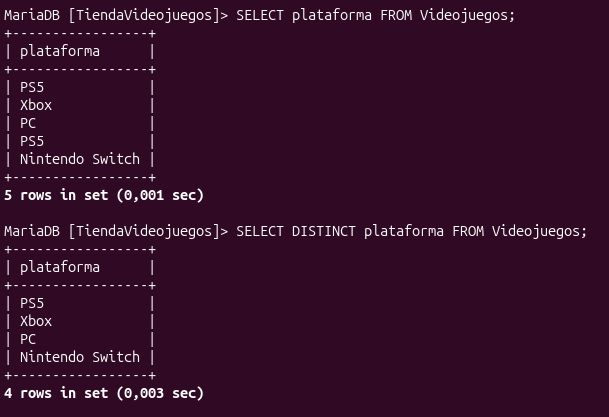

* Primera consulta (`SELECT plataforma FROM Videojuegos;`): Muestra los 5 registros totales de la tabla.

* Segunda consulta (`SELECT DISTINCT plataforma FROM Videojuegos;`): Filtra y elimina los duplicados, devolviendo únicamente 4 filas.

## 🔤 13. Alias

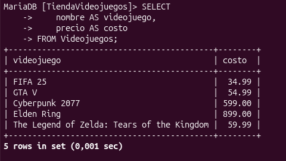

* **Explicación:** Esta consulta selecciona las columnas `nombre` y `precio`, pero cambia sus encabezados en pantalla por `videojuego` y `costo`.

## 🔀 14. AND / OR / NOT

**Consulta A: Dos condiciones utilizando AND**

* Pregunta: ¿Cuáles videojuegos pertenecen a la plataforma PS5 y tienen un precio menor a 50.00?

* SQL:
`SELECT * FROM Videojuegos WHERE plataforma = 'PS5' AND precio < 50.00;`

* Resultado:
`FIFA 25` | `PS5` | `34.99`

* Explicación: El operador AND exige que ambas condiciones se cumplan.

**Consulta B: Dos condiciones utilizando OR**

* Pregunta: ¿Qué videojuegos pertenecen a la plataforma PC o a la plataforma Xbox?

* SQL:
SELECT * FROM Videojuegos WHERE plataforma = 'PC' OR plataforma = 'Xbox';

* Resultado:
`GTA V` | `Xbox`
`Cyberpunk 2077` | `PC`

* Explicación: El operador OR es más flexible; basta con que se cumpla al menos una de las condiciones para que el registro sea seleccionado e incluido en los resultados de la consulta.

**Consulta C: Una condición negada utilizando NOT**

* Pregunta: ¿Cuáles videojuegos NO pertenecen a la plataforma PS5?

* SQL:
`SELECT * FROM Videojuegos WHERE NOT plataforma = 'PS5';`

* Resultado:

`GTA V` | `Xbox`
`Cyberpunk 2077` | `PC`
`The Legend of Zelda: Tears of the Kingdom` | `Nintendo Switch`

* Explicación: El operador `NOT` hace que no busque la información que se indique.

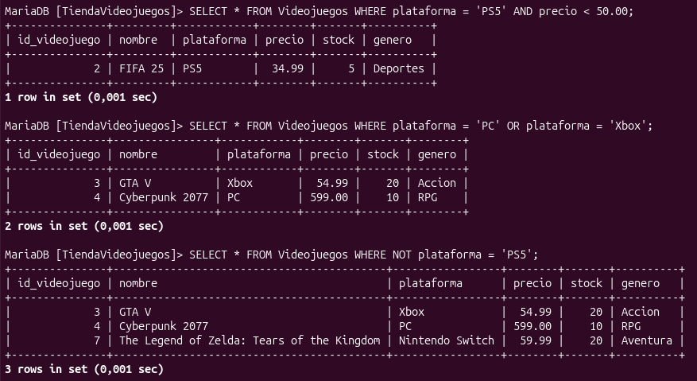

## 📊 15. ORDER BY

**1. Orden ascendente (`ASC`) con columna numérica (Precios)**

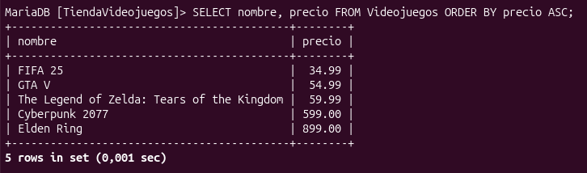

**2. Orden descendente (`DESC`) con columna numérica (Precios)**

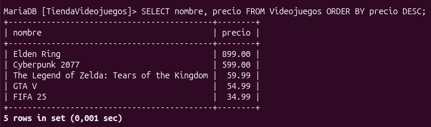

**3. Orden por una columna de texto (Nombres de los videojuegos)**

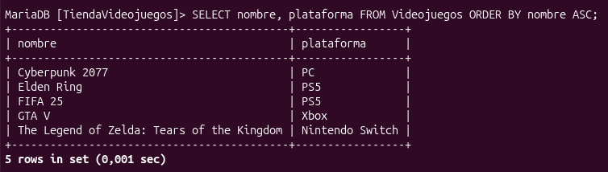

## 🔥 16. Diez preguntas de negocio

| # | Pregunta humana | SQL utilizado | Concepto |
|---|---|---|---|
| 1 | ¿Cuáles son los videojuegos que pertenecen exclusivamente a la plataforma de mayor preferencia (PS5)? | `SELECT nombre, plataforma FROM Videojuegos WHERE plataforma = 'PS5';` | Filtrado básico por igualdad (`=`) |
| 2 | ¿Qué títulos del inventario superan las 100 unidades monetarias de costo para considerarse de gama alta? | `SELECT nombre, precio FROM Videojuegos WHERE precio > 100.00;` | Operador de comparación mayor que (`>`) |
| 3 | ¿Cuáles son los productos más económicos del catálogo cuyo precio es menor a 60.00? | `SELECT nombre, precio FROM Videojuegos WHERE precio < 60.00;` | Operador de comparación menor que (`<`) |
| 4 | ¿Qué videojuegos cuentan con una disponibilidad en almacén mayor o igual a 20 unidades para evitar desabasto? | `SELECT nombre, stock FROM Videojuegos WHERE stock >= 20;` | Operador mayor o igual que (`>=`) |
| 5 | ¿Cuáles títulos tienen un stock crítico menor o igual a 5 unidades que requieran reabastecimiento urgente? | `SELECT nombre, stock FROM Videojuegos WHERE stock <= 5;` | Operador menor o igual que (`<=`) |
| 6 | ¿Qué juegos de la tienda inician con la letra 'F' en su nombre corporativo o comercial? | `SELECT * FROM Videojuegos WHERE nombre LIKE 'F%';` | Búsqueda por patrón inicial (`LIKE`) |
| 7 | ¿Cuáles videojuegos están disponibles dentro del rango de plataformas principales (PS5, Xbox, PC)? | `SELECT * FROM Videojuegos WHERE plataforma IN ('PS5', 'Xbox', 'PC');` | Filtrado por conjunto de valores (`IN`) |
| 8 | ¿Qué productos se encuentran en un rango de precios intermedio entre 30.00 y 100.00 unidades? | `SELECT nombre, precio FROM Videojuegos WHERE precio BETWEEN 30.00 AND 100.00;` | Consulta por rangos numéricos (`BETWEEN`) |
| 9 | ¿Cuáles son los nombres únicos y diferentes de las consolas registradas en el sistema sin mostrar duplicados? | `SELECT DISTINCT plataforma FROM Videojuegos;` | Eliminación de registros repetidos (`DISTINCT`) |
| 10 | ¿Qué videojuegos del género RPG tienen un precio superior a 500.00 organizados del más caro al más barato? | `SELECT nombre, genero, precio FROM Videojuegos WHERE genero = 'RPG' AND precio > 500.00 ORDER BY precio DESC;` | Consultas combinadas (`AND`) y ordenamiento (`ORDER BY DESC`) |

## 🧪 17. Consultas incorrectas y correcciones

### ❌ Caso A: Videojuegos del género RPG

* Pregunta humana: "Videojuegos que pertenecen al género RPG."

* Consulta incorrecta: `SELECT * FROM Videojuegos;`

* ¿Por qué no responde exactamente la pregunta?:
Porque devuelve todo el catálogo de la tienda sin filtrar por género, trayendo registros de Acciones, Deportes y Aventuras que no fueron solicitados. La consulta correcta requeriría `WHERE genero = 'RPG'`.

### ❌ Caso B: Videojuegos cuyo nombre empieza con 'F'

* Consulta incorrecta: `SELECT * FROM Videojuegos WHERE nombre = 'F';`

* ¿Por qué podría no funcionar como se esperaba?:
Porque el operador = busca una coincidencia exacta. Buscará un juego que se llame literalmente 'F', por lo que no encontrará títulos reales como FIFA 25. Para que funcione, se debe usar el comodín con LIKE 'F%'.

### ❌ Caso C: Videojuegos sin género asignado

* Consulta incorrecta: `SELECT * FROM Videojuegos WHERE genero = NULL;`

* ¿Por qué debemos investigar IS NULL?:
Porque en SQL los valores nulos (NULL) no se pueden comparar con el signo =. Escribir = NULL siempre fallará. Es obligatorio usar el operador específico IS NULL para detectar los campos vacíos en la base de datos.

### ❌ Caso D: Videojuegos de plataformas PS5 o Xbox

* Consulta incorrecta: `SELECT * FROM Videojuegos WHERE plataforma = 'PS5';`

* ¿Por qué está incompleta?:
Porque solo está filtrando los juegos de PS5, ignorando por completo los de Xbox que también formaban parte de la condición solicitada. Para incluir varias opciones se debe usar el operador IN (ej. WHERE plataforma IN ('PS5', 'Xbox')).

## 🧠 18. Investigación

🧠 60. Reto de Investigación
1. ¿Qué diferencia existe entre WHERE y HAVING?

* WHERE: Se utiliza para filtrar filas individuales antes de que se realice cualquier operación de agrupación o agregación. Actúa directamente sobre los datos base de la tabla.

* HAVING: Se utiliza para filtrar grupos de datos después de que se han aplicado funciones de agregación (como COUNT, SUM, AVG, etc.) mediante un GROUP BY.

* ¿Por qué lo veremos posteriormente?: Lo estudiaremos más adelante porque en las etapas avanzadas del curso comenzaremos a trabajar con resúmenes, estadísticas y agrupaciones de datos. En ese punto, el WHERE ya no será suficiente por sí solo, ya que necesitamos una herramienta capaz de filtrar el resultado de esas operaciones grupales.

2. Diferencia entre NULL, 0 y '' (cadena vacía)

* NULL: Representa la ausencia total de valor, un dato desconocido o no asignado. No ocupa un espacio numérico ni de texto y no puede compararse con operadores tradicionales (=, <>), requiriendo obligatoriamente IS NULL.

* 0: Es un valor numérico válido y definido. Representa una cifra exacta (cero), ocupa espacio de almacenamiento numérico y participa de forma normal en operaciones aritméticas y comparaciones.

* `''` (Cadena vacía): Es un valor de texto válido, pero con una longitud de cero caracteres. A diferencia de NULL, sí se considera un dato registrado (una cadena de texto en blanco), por lo que sí puede evaluarse con operadores de texto o funciones de longitud.

3. ¿Las comparaciones de texto pueden verse afectadas por la configuración de la base de datos?

* Sí, totalmente. Las comparaciones y ordenamientos de texto dependen directamente del Cotejamiento (Collation) y del Juego de Caracteres (Character Set) configurados en la base de datos, tabla o columna.

* Por ejemplo, un cotejamiento case-insensitive (insensible a mayúsculas/minúsculas) tratará 'A' y 'a' como exactamente iguales, mientras que uno case-sensitive las distinguirá. De igual manera, la configuración determina cómo se tratan los caracteres especiales y acentuados (por ejemplo, si la letra á es tratada como igual o diferente a a).

4. ¿Qué ocurre si utilizamos LIKE '%texto%' sobre una tabla muy grande?

* Provoca una fuerte degradación del rendimiento (un Full Table Scan).

* Al colocar un comodín al inicio (% antes del texto), el motor de la base de datos no puede utilizar los índices creados en esa columna para acelerar la búsqueda. Como resultado, MariaDB se ve obligada a leer y escanear absolutamente todas las filas de la tabla una por una para verificar si contienen la subcadena en cualquier posición, lo que vuelve la consulta extremadamente lenta en tablas con millones de registros.

### 🧠 70. Investigación con fuentes

* **Fuente:** Documentación Oficial de MariaDB / Manual de Referencia de SQL y Bases de Datos Relacionales.
* **Tema consultado:** Fundamentos de consulta, proyección, filtrado y operadores en SQL (`SELECT`, `WHERE`, operadores, `LIKE`, `IN`, `BETWEEN`, `NULL`, `DISTINCT`, alias).
* **¿Qué aprendí?:** 
  * Comprendí que la sentencia `SELECT` combinada con `FROM` forma el núcleo de las consultas de solo lectura (DQL), permitiendo extraer columnas específicas sin alterar la estructura de la base de datos.
  * Aprendí el uso correcto de los operadores de comparación y lógicos (`AND`, `OR`, `NOT`), los cuales permiten establecer criterios estrictos o flexibles para filtrar registros.
  * Entendí cómo funcionan las búsquedas por patrones de texto utilizando comodines con `LIKE`, la evaluación de listas discretas con `IN`, los rangos numéricos inclusivos con `BETWEEN`, y la restricción lógica de que los valores vacíos o desconocidos requieren obligatoriamente el operador `IS NULL`.
  * Reconocí el propósito de `DISTINCT` para purgar duplicados en los resultados y la utilidad de los alias (`AS`) para mejorar la presentación visual y la legibilidad de los reportes de manera temporal.
* **¿Cómo lo comprobé en mi base?:** 
  * Se ejecutaron y contrastaron todas las instrucciones directamente en la base de datos `TiendaVideojuegos` sobre la tabla `Videojuegos`. 
  * Se verificó experimentalmente la diferencia entre consultas sin filtro y con filtro, el comportamiento exacto al buscar cadenas con `LIKE`, el filtrado por conjuntos de plataformas con `IN`, la correcta gestión de duplicados con `DISTINCT` y la aplicación visual de los alias en los encabezados devueltos por la terminal de MariaDB.
  
## 🔥 19. Reto final

### 🔥 72. GRAN RETO — "EL DIRECTOR PREGUNTA"
1. **"Dame todos los registros de una tabla."**
   * **SQL:** `SELECT * FROM Videojuegos;`
2. **"Dame solamente tres columnas."**
   * **SQL:** `SELECT nombre, plataforma, precio FROM Videojuegos;`
3. **"Dame los registros que cumplan una condición."**
   * **SQL:** `SELECT * FROM Videojuegos WHERE plataforma = 'PS5';`
4. **"Dame los que estén dentro de un rango."**
   * **SQL:** `SELECT * FROM Videojuegos WHERE precio BETWEEN 30.00 AND 100.00;`
5. **"Dame los que pertenezcan a determinados valores."**
   * **SQL:** `SELECT * FROM Videojuegos WHERE plataforma IN ('PS5', 'Xbox', 'PC');`
6. **"Dame los que comiencen con determinada letra."**
   * **SQL:** `SELECT * FROM Videojuegos WHERE nombre LIKE 'F%';`
7. **"Dame los que contengan determinado texto."**
   * **SQL:** `SELECT * FROM Videojuegos WHERE nombre LIKE '%simulator%';`
8. **"Dame los que no tengan información en determinada columna."**
   * **SQL:** `SELECT * FROM Videojuegos WHERE genero IS NULL;`
9. **"Dame solamente los valores diferentes."**
   * **SQL:** `SELECT DISTINCT plataforma FROM Videojuegos;`
10. **"Dame los registros que cumplan dos condiciones."**
    * **SQL:** `SELECT * FROM Videojuegos WHERE plataforma = 'PS5' AND precio < 60.00;`

---

### **🧠 73. Reto Sin Ayuda: Guía de decisiones lógicas**
Ante la pregunta general *"Necesito obtener información de la base de datos que cumpla determinadas condiciones"*, el proceso mental de análisis estructurado es:
* **¿Qué tabla?:** Identificar la entidad principal involucrada (`Videojuegos` o `Ventas`).
* **¿Qué columnas?:** Definir si se requiere el registro completo (`*`) o campos específicos de proyección.
* **¿Necesito WHERE?:** Sí, siempre que se requiera filtrar filas específicas según un criterio determinado.
* **¿Qué operador?:** Seleccionar el operador de comparación adecuado (`=`, `>`, `<`, `>=`, `<=`, `<>`).
* **¿Necesito LIKE?:** Se emplea si la condición involucra patrones de texto parciales o comodines (`%`).
* **¿IN?:** Se utiliza si se necesita evaluar una columna frente a una lista cerrada de múltiples valores.
* **¿BETWEEN?:** Se selecciona cuando el filtro corresponde a un rango numérico o de fechas inclusivo.
* **¿NULL?:** Se activa estrictamente si se requiere evaluar la ausencia de información en una columna (`IS NULL` / `IS NOT NULL`).
* **¿AND / OR / NOT?:** Se aplican para combinar múltiples condiciones lógicas simultáneas, alternativas o negadas.

---

### **🧪 75. Reto "¿Cuál consulta es mejor?" (`OR` vs `IN`)**
* **¿Devuelven el mismo conjunto de datos?:** Sí, ambas consultas devuelven exactamente las mismas filas y columnas si se ejecutan bajo los mismos criterios.
* **¿Cuál es más legible?:** La Consulta B (`IN`), ya que su sintaxis es mucho más limpia y concentra todos los valores evaluados dentro de un solo conjunto entre paréntesis.
* **¿Cuál sería más fácil de ampliar?:** La Consulta B (`IN`), porque ampliarla solo requiere añadir un valor separado por coma dentro de los paréntesis.
* **¿En qué situación utilizarías cada una?:** 
  * *IN:* Para comparar una misma columna contra múltiples valores discretos.
  * *OR:* Para situaciones donde las condiciones involucran columnas totalmente diferentes.

---

### **🔍 76. Reto "¿Cuál consulta responde mejor?"**
* **Pregunta:** *"¿Qué registros tienen información registrada y pertenecen a una plataforma específica?"*
* **SQL utilizado:**
  ```sql
  SELECT * FROM Videojuegos 
  WHERE plataforma = 'PS5' 
    AND precio IS NOT NULL;
    
## 🧠 20. Reflexión

## 🧠 83. Reflexión Final

### **1. ¿Qué diferencia existe entre consultar todos los registros y consultar solamente los que responden a una pregunta?**
* **Respuesta:** Consultar todos los registros (`SELECT * FROM tabla;`) extrae la totalidad de los datos sin restricciones, lo cual resulta ineficiente y no aporta respuestas directas a una necesidad específica. En cambio, consultar solamente los que responden a una pregunta aplica filtros precisos mediante la cláusula `WHERE`, lo que permite aislar la información relevante y útil para la toma de decisiones o el análisis concreto.

### **2. ¿Cuál fue el filtro que más trabajo te costó?**
* **Respuesta:** El manejo de las combinaciones y la precedencia entre operadores lógicos (`AND` y `OR`), ya que requiere estructurar cuidadosamente la lógica matemática y el uso de paréntesis para asegurar que el motor de la base de datos evalúe las condiciones en el orden correcto y no devuelva resultados no deseados.

### **3. ¿Qué diferencia existe entre NULL y un valor vacío?**
* **Respuesta:** `NULL` representa la ausencia total de datos, un valor desconocido o no asignado que no puede evaluarse con operadores tradicionales y requiere la instrucción `IS NULL`. Por el contrario, un valor vacío (como una cadena de texto en blanco `''` o un número cero `0`) sí es un dato registrado, definido y válido dentro del sistema.

### **4. ¿Qué diferencia existe entre IN y utilizar varios OR?**
* **Respuesta:** Funcionalmente ambos resuelven el mismo problema al evaluar múltiples opciones para una misma columna, pero `IN` ofrece una sintaxis mucho más limpia, concisa y fácil de mantener a largo plazo. Utilizar varios `OR` alarga innecesariamente el código y lo vuelve más propenso a errores tipográficos.

### **5. ¿Qué problema resuelve LIKE?**
* **Respuesta:** Resuelve la incapacidad del operador de igualdad (`=`) para encontrar coincidencias parciales. Gracias al uso de comodines como `%` o `_`, `LIKE` permite buscar patrones de texto específicos sin importar si el fragmento se encuentra al inicio, en medio o al final de una cadena de caracteres.

### **6. ¿Qué problema resuelve BETWEEN?**
* **Respuesta:** Simplifica la escritura de consultas que involucran rangos numéricos o de fechas inclusivos. Evita tener que redactar condiciones dobles largas combinando operadores de mayor/menor igual (`>=` y `<=`) unidos por un `AND`.

### **7. ¿Qué problema resuelve DISTINCT?**
* **Respuesta:** Resuelve el problema de la duplicidad de datos en los resultados de una consulta. Permite filtrar y eliminar las filas repetidas de una columna para mostrar únicamente un listado limpio con los valores únicos o diferentes.

### **8. ¿Por qué debemos tener cuidado al combinar AND y OR?**
* **Respuesta:** Porque el motor de la base de datos evalúa los operadores bajo reglas de precedencia específicas. Si no se utilizan paréntesis para agrupar correctamente las condiciones, la consulta puede arrojar resultados erróneos o completamente distintos a los que el usuario conceptualmente diseñó.

### **9. ¿Por qué una consulta técnicamente correcta puede no responder la pregunta del usuario?**
* **Respuesta:** Porque la sintaxis puede estar perfecta (sin errores de ejecución en MariaDB), pero la lógica semántica es incorrecta. Esto ocurre si se filtran columnas equivocadas, si se usa una igualdad estricta (`=`) en lugar de un patrón (`LIKE`), o si se ignoran condiciones clave solicitadas en el planteamiento original del problema.

### **10. ¿Qué aprendiste esta semana que utilizarás en las consultas de la Semana 06?**
* **Respuesta:** Aprendí a dominar la proyección de datos, el filtrado avanzado con operadores lógicos y relacionales, la gestión correcta de valores nulos y el ordenamiento de resultados. Todo esto constituye la base fundamental y necesaria para construir consultas más complejas, uniones de tablas (*JOINs*) y funciones de agregación que se abordarán en la Semana 06.
